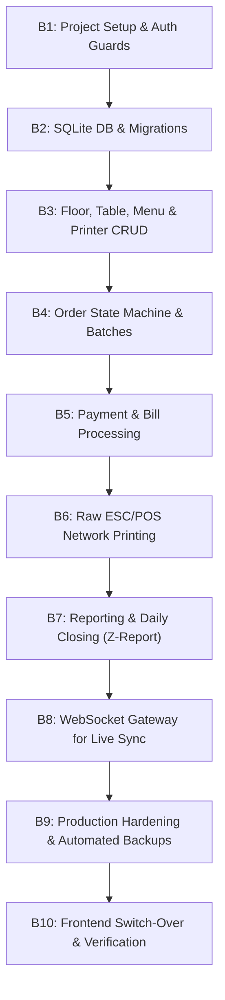

# Step-by-Step Backend Implementation Plan (FastAPI + SQLite + ESC/POS Printing)

This document provides the complete, chronological implementation blueprint for the backend engineer to build the production backend for the Soufi Restaurant POS.

The frontend is complete and operates against the contracts specified in:
- `docs/api/API_CONTRACT.md`
- `docs/api/openapi.yaml`
- `docs/api/DATA_MODEL.md`
- `docs/api/fixtures/*.json`

---

## Roadmap Overview



---

## Phase B1: Project Setup, Config & Auth Guards

### Goal
Establish the FastAPI application foundation with strict Pydantic settings, CORS, and JWT bearer authentication.

### Deliverables
1. **Directory Structure**:
   ```
   backend/
   ├── app/
   │   ├── api/
   │   │   ├── v1/
   │   │   │   ├── endpoints/
   │   │   │   └── api.py
   │   ├── core/
   │   │   ├── config.py
   │   │   ├── security.py
   │   │   └── database.py
   │   ├── models/
   │   ├── schemas/
   │   ├── services/
   │   └── main.py
   ├── alembic/
   ├── pyproject.toml / requirements.txt
   └── README.md
   ```
2. **CORS Configuration**: Allow `http://localhost:3000` and local LAN subnets.
3. **Endpoints**:
   - `POST /api/auth/login`: Accepts `{ username, password }`, verifies against configured staff accounts with BCrypt/Argon2. Returns `{ token, user, expiresAt }`.
   - `GET /api/auth/me`: Validates `Authorization: Bearer <token>`, returns current `User`.
   - `POST /api/auth/logout`: Returns `{ success: true }`.
4. **Security Dependencies**:
   - `get_current_user`: Decodes JWT, validates expiry (12h standard shift).
   - `require_admin`: Dependency raising `403 Forbidden` if `user.role != 'admin'`.
   - `require_floor_access(floor_id)`: Raises `403` if waiter lacks permission for requested floor.

### Acceptance Criteria
- Calling `POST /api/auth/login` with `admin` / `admin123` returns 200 with JWT token and user profile.
- Wrong password returns 401.
- Expired or malformed token returns 401.

---

## Phase B2: SQLite Database Schema & Migrations

### Goal
Implement relational schema with SQLAlchemy 2.0 (async or sync) and Alembic migrations following `docs/api/DATA_MODEL.md`.

### Deliverables
1. **SQLite PRAGMAs initialization**:
   ```python
   @event.listens_for(engine, "connect")
   def set_sqlite_pragma(dbapi_connection, connection_record):
       cursor = dbapi_connection.cursor()
       cursor.execute("PRAGMA journal_mode=WAL")
       cursor.execute("PRAGMA busy_timeout=5000")
       cursor.execute("PRAGMA synchronous=NORMAL")
       cursor.execute("PRAGMA foreign_keys=ON")
       cursor.close()
   ```
2. **Models**:
   - `User`, `Floor`, `Table`, `Category`, `MenuItem`, `Printer`, `Order`, `OrderItem`, `IdempotencyKey`, `DailySequence`.
3. **Alembic migration script**: Generates all tables with indexes on `orders(floor_id, paid_at)`, `orders(table_id, status)`.
4. **Database Seeder**: Scripts initial data identical to `src/lib/api/mock/seed.ts` (2 floors, 18 tables, 4 printers, categories, menu items, 4 staff users).

### Acceptance Criteria
- Database initializes cleanly in `pos.db`.
- Foreign key constraints prevent orphaned records.
- Seeder populates initial state with zero errors.

---

## Phase B3: Management CRUD Services (Floors, Tables, Menu, Printers)

### Goal
Implement catalog and hardware management endpoints matching the frontend contract.

### Deliverables
1. **Floors API**:
   - `GET /api/floors`: List all floors with table counts.
   - `GET /api/floors/{slug}`: Lookup by `floor-1` or `floor-2`.
2. **Tables API**:
   - `GET /api/tables?floorId=`: Filter tables by floor.
   - `POST /api/tables`: Single table creation (validates number uniqueness per floor).
   - `POST /api/tables/bulk`: Bulk table number generator (`fromNumber` to `toNumber`).
   - `PUT /api/tables/{id}`: Update table number/capacity.
   - `DELETE /api/tables/{id}`: Delete table; returns 409 if status is `occupied`. If order history exists, sets `is_active = false` (soft-delete).
3. **Categories & Menu Items API**:
   - `GET /api/menu?floorId=`: Full floor menu with categories and items grouped.
   - `POST /api/categories`, `PUT /api/categories/{id}`, `DELETE /api/categories/{id}` (409 if items attached).
   - `POST /api/categories/reorder`: Persist category sort orders.
   - `POST /api/menu-items`: Create food item.
   - `PATCH /api/menu-items/{id}/availability`: Instant 86 toggle.
   - `POST /api/menu-items/{id}/duplicate`: Copy item across floors.
4. **Printers API**:
   - `GET /api/printers`, `POST /api/printers`, `PUT /api/printers/{id}`.
   - `POST /api/printers/{id}/test`: TCP ping and test slip transmission.

### Acceptance Criteria
- All schemas match `src/lib/api/schemas/index.ts`.
- Soft-delete works when historic data exists; hard delete when clean.

---

## Phase B4: Orders Engine, Batches & Idempotency

### Goal
Build the high-concurrency order placement and kitchen slip transmission engine.

### Deliverables
1. **Idempotency Layer**:
   - Interceptor/dependency inspecting `requestId` header or payload field.
   - If `requestId` exists in `idempotency_keys` table and is < 24h old, return stored JSON response immediately.
2. **Order Placement (`POST /api/orders/send`)**:
   - If table is `free`, create new `Order` with `status = 'open'`, assign `batchNo = 1`, and update table to `occupied`.
   - If table is already `occupied`, fetch existing open order, increment `batchNo = max(batchNo) + 1`, and append items.
   - Atomic transaction updates order `subtotal`, `tax` (0.05 default), and `total`.
   - Returns `SendResult` with generated `printJobs`.
3. **Kitchen Reprint (`POST /api/orders/reprint`)**:
   - Dispatches reprint slip with `*** REPRINT ***` header for requested category batch.
4. **Item Voiding (`POST /api/orders/{id}/void-item`)**:
   - Guarded by `require_admin`. Waiters calling this receive `403`.
   - Marks item as `voided = true`, stores `voidReason` and `voidedBy`.
   - Recalculates order subtotal, tax, and total.
   - Generates kitchen cancellation slip (`*** VOID / CANCELLED ***`).

### Acceptance Criteria
- Rapid double-clicks with identical `requestId` only place the batch once.
- Table status transitions atomically to `occupied`.
- Waiters cannot void items; admins can.

---

## Phase B5: Payment Processing & Bill Sequences

### Goal
Implement cashier checkout, bill number generation, change calculation, and table release.

### Deliverables
1. **Daily Sequence Counter**:
   - Thread-safe increment in SQLite table resetting at midnight (`B-0001`, `B-0002`...).
2. **Order Settlement (`POST /api/orders/{id}/pay`)**:
   - Validates that order has at least 1 non-voided item.
   - Validates cash tendered: `amountReceived >= total` (returns 422 if insufficient).
   - Computes discounts (`amount` or `percent`).
   - Updates order: `status = 'paid'`, `billNo`, `paymentMethod`, `changeDue`, `paidAt`.
   - Updates table: `status = 'free'`, `currentOrderId = null`, `runningTotal = 0`.
   - Dispatches `PrintJob` to cashier thermal printer.
3. **Bill Listing (`GET /api/orders/paid`)**:
   - Paginated list with date, floor, payment method, and search filters.
4. **Reprint Bill (`POST /api/orders/{id}/reprint-bill`)**:
   - Returns 400 if order is not paid.
   - Dispatches bill slip with `*** DUPLICATE RECEIPT ***` watermark.

### Acceptance Criteria
- Table immediately turns `free` after payment.
- Change due is accurately calculated and recorded.
- Bill numbers never clash or skip during concurrent checkouts.

---

## Phase B6: Network ESC/POS Thermal Printing Service

### Goal
Direct, raw TCP socket printing to kitchen and cashier printers (port 9100).

### Deliverables
1. **Network Driver (`app/services/printer.py`)**:
   - Raw socket client with 2.5-second connection timeout.
   - ESC/POS byte sequence generation (init, bold, double height/width, alignment, paper cut `GS V 66 0`).
2. **Templates (80mm width, 42-48 columns)**:
   - Kitchen Order Slip (Table #, Floor, Waiter, Batch #, Time, Qty & Notes).
   - Kitchen Cancel / Void Slip (Big bold VOID warning, Reason, Authorizer).
   - Customer Bill Receipt (Restaurant header, Tax details, Itemized lines, Discounts, Total, Change, Barcode/QR).
   - Daily Closing Z-Report.
3. **Fallback & Retry Queue**:
   - If TCP connection fails (printer offline/out of paper), mark `PrintJob.status = 'failed'` with descriptive error.
   - Cache in background retry queue without blocking the HTTP request.

### Acceptance Criteria
- Test print triggers paper cut on hardware.
- Offline printer returns a graceful `PrintJob { status: "failed", error: "..." }` without failing the HTTP response.

---

## Phase B7: Reporting & Daily Closing (Z-Report)

### Goal
Perform fast SQL aggregations for sales performance and daily financial closing.

### Deliverables
1. **Analytics Endpoints**:
   - `GET /api/reports/summary`: Gross sales, net sales, taxes, discounts, order counts, and comparison with previous period.
   - `GET /api/reports/sales-over-time`: Bucketed by hour or day.
   - `GET /api/reports/by-category`: Revenue and item quantity share.
   - `GET /api/reports/by-floor`: Halal vs Non-halal breakdown.
   - `GET /api/reports/by-waiter`: Orders and sales per staff member.
   - `GET /api/reports/top-items`: Volume ranker.
   - `GET /api/reports/by-payment-method`: Cash vs Card vs Online mix.
   - `GET /api/reports/peak-hours`: Heatmap matrix.
   - `GET /api/reports/discounts`: Total discounts granted.
   - `GET /api/reports/voided-items`: Audit log of cancellations.
2. **Daily Closing Endpoint (`GET /api/reports/daily-closing?date=YYYY-MM-DD`)**:
   - Comprehensive end-of-day reconciliation data ready for physical Z-Slip print.

### Acceptance Criteria
- Only `paid` orders count towards revenue.
- Voided items are excluded from sales and tracked under audit.
- Query execution takes under 150ms on SQLite.

---

## Phase B8: Real-Time WebSocket Gateway

### Goal
Provide instantaneous multi-device synchronization to replace polling.

### Deliverables
1. **WebSocket Endpoint**: `ws://<host>:<port>/ws?token=<jwt>`
2. **Channel Manager**:
   - Tracks active waiter and cashier clients.
   - Broadcasts events:
     - `table.updated`: Table status or running total changed.
     - `order.updated`: New batch placed or item voided.
     - `menu.changed`: Item 86 toggle or price update.
     - `printer.status`: Printer offline/online warning.
     - `bill.paid`: Bill closed, table freed.
3. **Heartbeat**: 30-second ping/pong keepalive.

### Acceptance Criteria
- Order placed on Tablet A reflects on Tablet B within 50ms without page reload.

---

## Phase B9: Production Hardening & Backup Strategy

### Goal
Ensure high availability on local restaurant hardware (mini-PC or POS terminal).

### Deliverables
1. **Process Supervisor**: Systemd unit file or Docker Compose with `restart: always`.
2. **Automated SQLite Backup Job**:
   - Nightly SQLite VACUUM INTO backup using cron or background scheduler:
     ```python
     db.execute(text("VACUUM INTO 'backups/pos_backup_' || strftime('%Y%m%d_%H%M%S', 'now') || '.db'"))
     ```
   - Retain 30 daily rotating backups.
3. **Structured Logging**: Log all financial operations and printing errors with log rotation.

---

## Phase B10: Frontend Switch-Over Checklist

When the backend implementation is ready:

1. **Environment Config (`.env.local`)**:
   ```env
   NEXT_PUBLIC_API_URL=http://<BACKEND_LAN_IP>:8000/api
   NEXT_PUBLIC_USE_MOCK=false
   ```
2. **Sanity Verification**:
   - Run `npm run check` on frontend repository.
   - Verify login with admin and waiter credentials.
   - Verify table grid loads from SQLite.
   - Open table, send batch of items, verify physical kitchen print.
   - Void an item with admin PIN/role, verify cancel slip.
   - Process payment with cash, verify cashier bill print and green table.
   - Check reports dashboard for real-time reflection of paid order.

