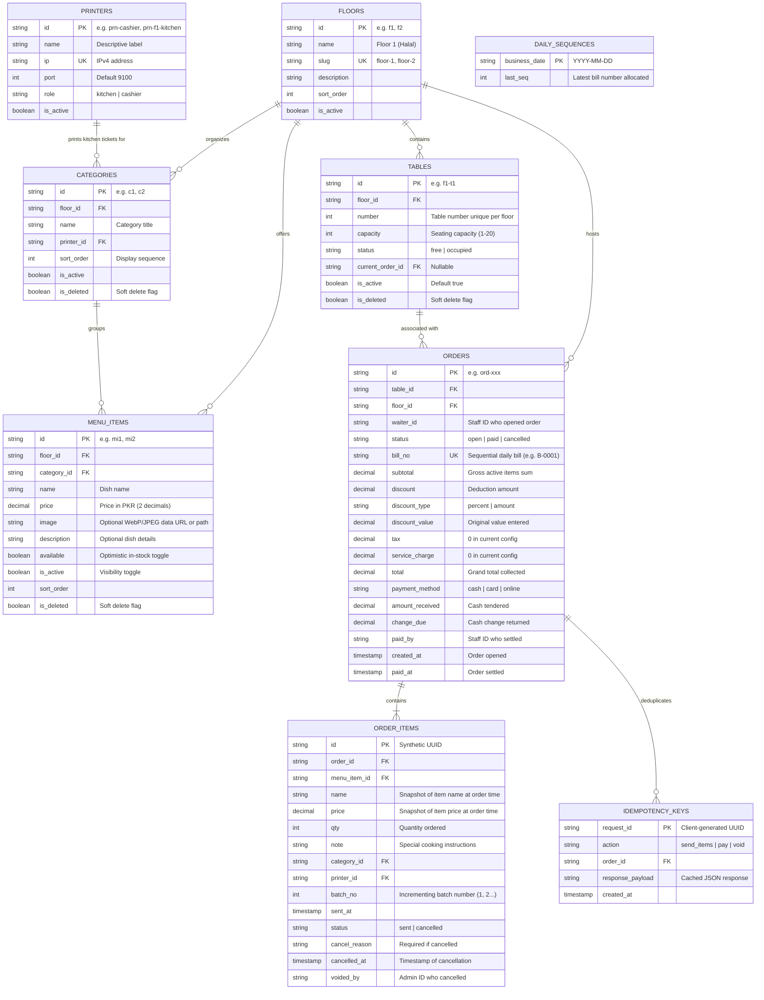

# POS Relational Data Model Specification

This document defines the relational database schema, integrity constraints, indexing strategy, and SQLite concurrency parameters required for the FastAPI backend.

---

## 1. Entity-Relationship Diagram (Mermaid)



---

## 2. Table Schemas & Column Definitions

### 2.1 `floors`
| Column | Type | Constraints | Description |
| :--- | :--- | :--- | :--- |
| `id` | `VARCHAR(32)` | `PRIMARY KEY` | Unique identifier (e.g. `"f1"`, `"f2"`) |
| `name` | `VARCHAR(100)` | `NOT NULL` | Display title (e.g. `"Floor 1 (Halal)"`) |
| `slug` | `VARCHAR(50)` | `UNIQUE, NOT NULL` | URL routing slug (`"floor-1"`, `"floor-2"`) |
| `description` | `TEXT` | `NULLABLE` | Optional summary |
| `sort_order` | `INTEGER` | `NOT NULL, DEFAULT 0` | Display tab sequence |
| `is_active` | `BOOLEAN` | `NOT NULL, DEFAULT 1` | Floor active status |

### 2.2 `tables`
| Column | Type | Constraints | Description |
| :--- | :--- | :--- | :--- |
| `id` | `VARCHAR(32)` | `PRIMARY KEY` | Synthetic format `{floorId}-t{n}` or UUID |
| `floor_id` | `VARCHAR(32)` | `NOT NULL, REFERENCES floors(id)` | Target dining floor |
| `number` | `INTEGER` | `NOT NULL` | Physical table number (1 to 999) |
| `capacity` | `INTEGER` | `NOT NULL, DEFAULT 4` | Seating capacity |
| `status` | `VARCHAR(20)` | `NOT NULL, DEFAULT 'free'` | `'free'` or `'occupied'` |
| `current_order_id` | `VARCHAR(64)` | `NULLABLE` | FK to currently open order |
| `is_active` | `BOOLEAN` | `NOT NULL, DEFAULT 1` | Active in floor grid |
| `is_deleted` | `BOOLEAN` | `NOT NULL, DEFAULT 0` | Soft delete flag |
*Constraints*: `UNIQUE(floor_id, number)` where `is_deleted = 0`.

### 2.3 `printers`
| Column | Type | Constraints | Description |
| :--- | :--- | :--- | :--- |
| `id` | `VARCHAR(64)` | `PRIMARY KEY` | e.g. `"prn-cashier"`, `"prn-f1-kitchen"` |
| `name` | `VARCHAR(100)` | `NOT NULL` | Descriptive name (e.g. `"Cashier Printer"`) |
| `ip` | `VARCHAR(45)` | `UNIQUE, NOT NULL` | IPv4 address |
| `port` | `INTEGER` | `NOT NULL, DEFAULT 9100` | Standard RAW ESC/POS port |
| `role` | `VARCHAR(20)` | `NOT NULL` | `'kitchen'` or `'cashier'` |
| `is_active` | `BOOLEAN` | `NOT NULL, DEFAULT 1` | Enabled for print jobs |

### 2.4 `categories`
| Column | Type | Constraints | Description |
| :--- | :--- | :--- | :--- |
| `id` | `VARCHAR(32)` | `PRIMARY KEY` | Unique ID (e.g. `"c1"`, `"c2"`) |
| `floor_id` | `VARCHAR(32)` | `NOT NULL, REFERENCES floors(id)` | Menu floor separation |
| `name` | `VARCHAR(100)` | `NOT NULL` | Title (e.g. `"Sweet Dishes"`) |
| `printer_id` | `VARCHAR(64)` | `NOT NULL, REFERENCES printers(id)` | Kitchen station printer routing |
| `sort_order` | `INTEGER` | `NOT NULL, DEFAULT 0` | Tab position |
| `is_active` | `BOOLEAN` | `NOT NULL, DEFAULT 1` | Enabled in POS |
| `is_deleted` | `BOOLEAN` | `NOT NULL, DEFAULT 0` | Soft delete flag |

### 2.5 `menu_items`
| Column | Type | Constraints | Description |
| :--- | :--- | :--- | :--- |
| `id` | `VARCHAR(32)` | `PRIMARY KEY` | Dish identifier (e.g. `"mi1"`, `"mi2"`) |
| `floor_id` | `VARCHAR(32)` | `NOT NULL, REFERENCES floors(id)` | Floor allocation |
| `category_id` | `VARCHAR(32)` | `NOT NULL, REFERENCES categories(id)`| Food section |
| `name` | `VARCHAR(150)` | `NOT NULL` | Dish name |
| `price` | `DECIMAL(10,2)`| `NOT NULL` | Base price in PKR |
| `image` | `TEXT` | `NULLABLE` | WebP data URL or static asset path |
| `description` | `TEXT` | `NULLABLE` | Preparation notes |
| `available` | `BOOLEAN` | `NOT NULL, DEFAULT 1` | In-stock toggle |
| `is_active` | `BOOLEAN` | `NOT NULL, DEFAULT 1` | Visible in POS catalog |
| `sort_order` | `INTEGER` | `NOT NULL, DEFAULT 0` | Grid sequence |
| `is_deleted` | `BOOLEAN` | `NOT NULL, DEFAULT 0` | Soft delete flag |

### 2.6 `orders`
| Column | Type | Constraints | Description |
| :--- | :--- | :--- | :--- |
| `id` | `VARCHAR(64)` | `PRIMARY KEY` | Order identifier (`"ord-xxx"`) |
| `table_id` | `VARCHAR(32)` | `NOT NULL, REFERENCES tables(id)` | Table served |
| `floor_id` | `VARCHAR(32)` | `NOT NULL, REFERENCES floors(id)` | Dining floor |
| `waiter_id` | `VARCHAR(32)` | `NOT NULL` | Staff member who opened |
| `status` | `VARCHAR(20)` | `NOT NULL` | `'open'` \| `'paid'` \| `'cancelled'` |
| `bill_no` | `VARCHAR(20)` | `UNIQUE, NULLABLE` | Assigned on payment (`"B-0001"`) |
| `subtotal` | `DECIMAL(10,2)`| `NOT NULL, DEFAULT 0.00` | Sum of non-voided item lines |
| `discount` | `DECIMAL(10,2)`| `NOT NULL, DEFAULT 0.00` | Deducted monetary amount |
| `discount_type`| `VARCHAR(20)` | `NULLABLE` | `'percent'` or `'amount'` |
| `discount_value`| `DECIMAL(10,2)`| `NULLABLE` | Raw input (e.g. `10` for 10%) |
| `tax` | `DECIMAL(10,2)`| `NOT NULL, DEFAULT 0.00` | Sales tax (0 in default config) |
| `service_charge`| `DECIMAL(10,2)`| `NOT NULL, DEFAULT 0.00` | Service charge (0 in default) |
| `total` | `DECIMAL(10,2)`| `NOT NULL, DEFAULT 0.00` | `subtotal - discount + tax + service` |
| `payment_method`| `VARCHAR(20)` | `NULLABLE` | `'cash'` \| `'card'` \| `'online'` |
| `amount_received`| `DECIMAL(10,2)`| `NULLABLE` | Tender amount received from customer |
| `change_due` | `DECIMAL(10,2)`| `NULLABLE` | Change returned (`amountReceived - total`) |
| `paid_by` | `VARCHAR(32)` | `NULLABLE` | Staff member who completed payment |
| `created_at` | `TIMESTAMP` | `NOT NULL` | Order opening timestamp |
| `paid_at` | `TIMESTAMP` | `NULLABLE` | Payment timestamp (used for sales reports) |

### 2.7 `order_items`
| Column | Type | Constraints | Description |
| :--- | :--- | :--- | :--- |
| `id` | `VARCHAR(64)` | `PRIMARY KEY` | Item line synthetic ID |
| `order_id` | `VARCHAR(64)` | `NOT NULL, REFERENCES orders(id)`| Parent order ticket |
| `menu_item_id` | `VARCHAR(32)` | `NOT NULL` | Original menu item ID |
| `name` | `VARCHAR(150)` | `NOT NULL` | Immutable dish name snapshot |
| `price` | `DECIMAL(10,2)`| `NOT NULL` | Immutable unit price snapshot |
| `qty` | `INTEGER` | `NOT NULL` | Quantity ordered |
| `note` | `TEXT` | `NULLABLE` | Kitchen instructions |
| `category_id` | `VARCHAR(32)` | `NOT NULL` | Category snapshot |
| `printer_id` | `VARCHAR(64)` | `NOT NULL` | Target kitchen printer snapshot |
| `batch_no` | `INTEGER` | `NOT NULL` | Kitchen dispatch batch sequence |
| `sent_at` | `TIMESTAMP` | `NOT NULL` | Dispatch timestamp |
| `status` | `VARCHAR(20)` | `NOT NULL, DEFAULT 'sent'` | `'sent'` or `'cancelled'` |
| `cancel_reason`| `TEXT` | `NULLABLE` | Required if status is cancelled |
| `cancelled_at` | `TIMESTAMP` | `NULLABLE` | Cancellation timestamp |
| `voided_by` | `VARCHAR(32)` | `NULLABLE` | Admin who voided the item |

### 2.8 `idempotency_keys`
| Column | Type | Constraints | Description |
| :--- | :--- | :--- | :--- |
| `request_id` | `VARCHAR(64)` | `PRIMARY KEY` | Client UUID |
| `action` | `VARCHAR(50)` | `NOT NULL` | `'send_items'`, `'pay'`, `'void'` |
| `order_id` | `VARCHAR(64)` | `NOT NULL` | Associated order |
| `response_payload`| `TEXT` | `NOT NULL` | Cached JSON response |
| `created_at` | `TIMESTAMP` | `NOT NULL` | Timestamp for 24h retention cleanup |

### 2.9 `daily_sequences`
| Column | Type | Constraints | Description |
| :--- | :--- | :--- | :--- |
| `business_date` | `VARCHAR(10)` | `PRIMARY KEY` | Date string (`"YYYY-MM-DD"`) |
| `last_seq` | `INTEGER` | `NOT NULL, DEFAULT 0` | Last sequence allocated for bill number |

---

## 3. Stored vs Derived Columns & Accounting Rules

1. **Order Totals (`subtotal`, `discount`, `total`)**:
   - `subtotal = SUM(price * qty)` for all items in the order where `status != 'cancelled'`.
   - `discount`:
     - If `discount_type == 'percent'`: `discount = ROUND((subtotal * discount_value) / 100, 2)`.
     - If `discount_type == 'amount'`: `discount = MIN(subtotal, discount_value)`.
   - `total = subtotal - discount + tax + serviceCharge`.
   - *Rule*: Totals are recomputed atomically and persisted upon every item dispatch, void, and payment settlement.

2. **Daily Bill Number Sequence (`B-0001`)**:
   - Sequence resets each business day at `BUSINESS_DAY_START_HOUR` (midnight).
   - Generated inside a database transaction:
     ```sql
     INSERT INTO daily_sequences (business_date, last_seq) VALUES (:today, 1)
     ON CONFLICT(business_date) DO UPDATE SET last_seq = daily_sequences.last_seq + 1
     RETURNING last_seq;
     ```
   - Formatted as `'B-' || printf('%04d', last_seq)`.

---

## 4. SQLite Configuration Pragmas & Concurrency

The FastAPI backend runs on SQLite located on the local host drive (`pos.db`). To support 4 tablets submitting orders concurrently mid-rush:

```sql
PRAGMA journal_mode = WAL;            -- Write-Ahead Logging allows concurrent readers during writes
PRAGMA busy_timeout = 5000;          -- 5-second lock timeout before throwing busy errors
PRAGMA synchronous = NORMAL;         -- Excellent durability with minimal disk write latency
PRAGMA foreign_keys = ON;            -- Enforces referential integrity constraints
PRAGMA cache_size = -64000;          -- 64 MB in-memory cache
```

### Transaction Boundaries:
- **`ordersService.sendItems`**: Executed inside an atomic transaction:
  1. Check `idempotency_keys` table for existing `requestId`.
  2. If table is free, create new order and update `table.status = 'occupied'`.
  3. Insert `order_items` with incremented `batch_no`.
  4. Recalculate and update `orders` subtotal and total.
  5. Insert into `idempotency_keys`.
- **`ordersService.pay`**: Executed inside an atomic transaction:
  1. Allocate next daily `bill_no`.
  2. Mark `order.status = 'paid'`, set `paid_at`, `payment_method`, change due.
  3. Set `table.status = 'free'` and clear `table.current_order_id`.
  4. Record `idempotency_keys`.

