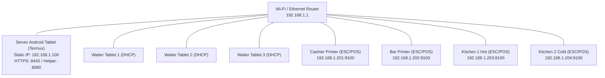

# Restaurant POS - Android Tablet (Termux) Deployment Guide

This guide describes how to deploy and operate the Restaurant POS server unattended on an **Android tablet** (under Termux), servicing 3–4 waiter tablets and 4 thermal receipt/kitchen printers over a local Wi-Fi router.

---

## 1. Network Topology & IP Plan

The POS system operates on an isolated local network (no cloud dependency required):



### Static IP Allocation Plan:
- `192.168.1.1`: Local Wi-Fi Router Gateway
- `192.168.1.100`: **Server Android Tablet** (Configured via Router DHCP Reservation / Static IP)
- `192.168.1.201`: Cashier Receipt Thermal Printer (Port 9100)
- `192.168.1.202`: Bar Thermal Printer (Port 9100)
- `192.168.1.203`: Kitchen Hot Kitchen Thermal Printer (Port 9100)
- `192.168.1.204`: Kitchen Cold Thermal Printer (Port 9100)
- `192.168.1.50 - 192.168.1.99`: Waiter tablets & mobile devices (DHCP dynamic lease)

---

## 2. Preparing the Server Android Tablet

### Hardware & Power Recommendations:
- Keep the server tablet permanently connected to high-quality AC power.
- If supported by the tablet vendor (Samsung, Lenovo, Xiaomi), enable **"Protect Battery"** (caps charge at 80% to avoid swelling).
- Use a dedicated tablet stand with proper ventilation.

### Android System Settings:
1. **Developer Options**:
   - Go to *Settings > About tablet* and tap *Build number* 7 times.
   - Go to *Settings > System > Developer options*:
     - Enable **Stay Awake** (screen does not sleep while charging).
     - On Android 14+, enable **Disable child process restrictions** (prevents Phantom Process Killer from terminating uvicorn/python background processes).
     - On Android 12–13, execute via adb if available:
       ```bash
       adb shell "settings put global settings_enable_monitor_phantom_procs false"
       ```
2. **Battery Optimization**:
   - Go to *Settings > Apps > Termux > Battery*:
     - Set to **Unrestricted** (prevent Android Doze mode from freezing network sockets).
   - If using Termux:Boot and Termux:API, set their battery profiles to **Unrestricted** as well.

---

## 3. Installing Termux (F-Droid Only)

> [!CAUTION]
> **DO NOT install Termux from the Google Play Store**. The Google Play version has been deprecated since 2020 due to Android API limitations and is completely broken.

1. Download and install **F-Droid** from [f-droid.org](https://f-droid.org/).
2. In F-Droid, search for and install:
   - **Termux** (Terminal emulator with packages)
   - **Termux:API** (Allows termux-wake-lock)
   - **Termux:Boot** (Enables auto-start on tablet reboot)
3. Open Termux on the tablet and grant storage permissions:
   ```bash
   termux-setup-storage
   ```
4. Acquire wake lock:
   ```bash
   termux-wake-lock
   ```

---

## 4. Installation: Plan A (Native Termux) vs Plan B (PRoot Ubuntu)

The POS server supports two deployment modes:

### Plan A: Native Termux (Lightweight)
Recommended for modern aarch64 devices where prebuilt wheels or TUR repo are accessible:
```bash
# Clone or transfer repository to $HOME/pos
cd $HOME
git clone <repository_url> pos
cd pos

# Run automated Termux diagnostic
bash scripts/termux_check.sh

# Run automated installer
bash scripts/install_termux.sh
```

### Plan B: PRoot Ubuntu (Universal manylinux compatibility)
If native wheels for `pydantic-core` fail to compile on older Termux variants, run the POS in an isolated Ubuntu PRoot environment where standard manylinux aarch64 binary wheels install without compiling:
```bash
cd $HOME/pos
bash scripts/install_proot.sh
```

### Dependency Compatibility Matrix (ARM64 / aarch64)

The backend dependencies have been validated against ARM64 architectures for both **Plan A (Native Termux Bionic libc)** and **Plan B (PRoot Ubuntu glibc manylinux)**:

| Package | Version | Type | ARM64 ManyLinux Wheel (Plan B) | Native Termux Bionic Status (Plan A) |
| :--- | :--- | :--- | :--- | :--- |
| `fastapi` | `0.128.0` | Pure Python | Available (`py3-none-any`) | Direct pip install |
| `uvicorn` | `0.40.0` | Pure Python | Available (`py3-none-any`) | Direct pip install |
| `starlette` | `0.50.0` | Pure Python | Available (`py3-none-any`) | Direct pip install |
| `pydantic` | `2.12.5` | Pure Python | Available (`py3-none-any`) | Direct pip install |
| `pydantic-settings` | `2.12.0` | Pure Python | Available (`py3-none-any`) | Direct pip install |
| `pydantic_core` | `2.41.5` | Compiled (Rust) | Available (`manylinux2014_aarch64`) | Pre-built in TUR (`pkg install python-pydantic-core`) or Plan B PRoot |
| `SQLAlchemy` | `2.0.45` | Compiled (C) | Available (`manylinux2014_aarch64`) | Compiles via `clang` or uses pure-Python fallback |
| `alembic` | `1.17.2` | Pure Python | Available (`py3-none-any`) | Direct pip install |
| `PyYAML` | `6.0.3` | Compiled (C) | Available (`manylinux2014_aarch64`) | Pre-built in Termux (`pkg install python-yaml`) |
| `python-multipart` | `0.0.21` | Pure Python | Available (`py3-none-any`) | Direct pip install |
| `websockets` | `16.0` | Compiled (C) | Available (`manylinux2014_aarch64`) | Compiles via `clang` or uses pure-Python fallback |
| `httpx` | `0.28.1` | Pure Python | Available (`py3-none-any`) | Direct pip install |
| `pytest` | `9.0.2` | Pure Python | Available (`py3-none-any`) | Direct pip install |
| `pytest-asyncio` | `1.3.0` | Pure Python | Available (`py3-none-any`) | Direct pip install |
| `pytest-timeout` | `2.4.0` | Pure Python | Available (`py3-none-any`) | Direct pip install |
| `anyio` | `4.12.0` | Pure Python | Available (`py3-none-any`) | Direct pip install |
| `segno` | `1.6.1` | Pure Python | Available (`py3-none-any`) | Direct pip install |

> [!NOTE]
> Native Termux uses Android's bionic libc, so binary wheels built for glibc (`manylinux`) cannot be used directly in native Termux unless installed through Termux's packaging system (TUR) or compiled on-device. PRoot Ubuntu runs full glibc on ARM64, enabling immediate, zero-compilation installation of all standard `manylinux_2_17_aarch64` wheels directly via `pip install -r backend/requirements.lock`.

---

## 5. LAN HTTPS Setup & Trusting the Root CA

Because modern mobile browsers (Chrome on Android, Safari on iOS) require HTTPS for Service Workers, WebSockets, and PWA offline caching, the POS features a custom LAN Root CA and automated certificate generator.

### Server Ports:
- **HTTPS Port (8443)**: Main POS application (`https://192.168.1.100:8443/`)
- **HTTP Helper Port (8080)**: Setup page & CA download (`http://192.168.1.100:8080/`)

### Installing CA Certificate on Waiter Tablets:
1. Connect waiter tablet to the restaurant Wi-Fi.
2. In Chrome / Safari, open:
   ```text
   http://192.168.1.100:8080/
   ```
3. Tap **"Download CA Certificate"** (downloads `pos-ca.crt`).
4. Install Certificate on Android:
   - Go to *Settings > Security (or Biometrics and security) > Encryption & credentials*.
   - Tap *Install a certificate > CA certificate*.
   - Tap *Install anyway* and select `pos-ca.crt`.
   - Name it `Restaurant POS Root CA`.
5. Open `https://192.168.1.100:8443/` — the lock icon will display green/secure without warnings.
6. In Chrome, tap *Add to Home Screen* to install the POS PWA app.

### Handling IP Address Changes:
If the restaurant router assigns a new LAN IP to the server tablet (e.g. `192.168.1.150`):
```bash
# Add the new IP to the certificate SAN without recreating the Root CA!
./scripts/pos certs add-ip 192.168.1.150
./scripts/pos restart
```
Waiter tablets will continue trusting the server with zero reinstallation of certificates!

---

## 6. Daily Operations with the `pos` CLI

The `pos` management script controls the server lifecycle:

| Command | Action |
| :--- | :--- |
| `./scripts/pos start` | Starts supervisor and uvicorn server in background with wake-lock |
| `./scripts/pos stop` | Gracefully stops the server and supervisor |
| `./scripts/pos restart` | Restarts the server |
| `./scripts/pos status` | Displays state (RUNNING/STOPPED), PID, restarts, and mode |
| `./scripts/pos logs` | Shows the last 50 lines of logs (`-f` to follow) |
| `./scripts/pos doctor` | Runs 10 diagnostic subsystems (DB, WAL, TLS, printers, disk) |
| `./scripts/pos backup` | Runs database backup and config/certificates tarball backup |
| `./scripts/pos urls --qr` | Displays local/LAN URLs and terminal QR code for onboarding |
| `./scripts/pos update <tar.gz>` | Safely updates POS to a new release bundle with auto-rollback |
| `./scripts/pos rollback` | Reverts to the previous release symlink |

---

## 7. Updates & Rollback

Updates are distributed as standalone tarball bundles (`pos-release-vX.Y.Z-YYYYMMDD.tar.gz`):
```bash
# 1. Transfer release bundle to tablet (via USB or curl)
# 2. Run atomic update
./scripts/pos update pos-release-v1.1.0-20261109.tar.gz
```
The updater automatically:
1. Performs a pre-update backup of `pos.db`, `.env`, `users.yaml`, and `certs/`.
2. Extracts the bundle into `$HOME/pos/releases/v1.1.0`.
3. Runs database migrations (`alembic upgrade head`).
4. Switches the atomic symlink `$HOME/pos/current`.
5. Restarts the service.
6. If any step fails, it halts and preserves the running release.

To roll back manually:
```bash
./scripts/pos rollback
```

---

## 8. On-Site Acceptance Checklist

Complete this checklist on-site before handing the system over to restaurant staff:

| Checkpoint | Description | Expected Result | Pass/Fail |
| :--- | :--- | :--- | :--- |
| **1. Power & Battery** | AC charger connected; battery protection active | Device charging, screen stays awake | [ ] |
| **2. Termux Boot** | Tablet reboot test | Server auto-starts via Termux:Boot within 30s | [ ] |
| **3. Wake-Lock** | Screen off power test | Server continues servicing requests when screen turns off | [ ] |
| **4. Diagnostic** | `./scripts/pos doctor` | All checks report PASS (or printer unreachable if off) | [ ] |
| **5. SQLite WAL** | `python scripts/sqlite_check.py` | Multi-reader/writer concurrency test passes without deadlocks | [ ] |
| **6. LAN HTTP Helper** | Visit `http://192.168.1.100:8080/` | Setup page loads; CA certificate downloads | [ ] |
| **7. HTTPS TLS Trust** | Visit `https://192.168.1.100:8443/` | Secure padlock displays; no SSL warnings | [ ] |
| **8. Multi-Tablet Order** | 3 waiter tablets placing orders simultaneously | All items appear on kitchen queue; no lost orders | [ ] |
| **9. Thermal Receipt** | Print test on cashier printer | ESC/POS 80mm slip feeds and cuts cleanly | [ ] |
| **10. KOT Kitchen Slip** | Send order with hot + cold items | Dishes route to appropriate kitchen printer | [ ] |
| **11. Cash / Card Pay** | Settle order via cash and card | Order marked paid; daily sales totals increment | [ ] |
| **12. Backup Verification** | `./scripts/pos backup` | Verified `.db.gz` and `.sha256` created in `data/backups/` | [ ] |

---

## 9. "To Verify on Device" Catalog

The following items are architecturally tested in Linux/Windows development environments and must be confirmed on real hardware during on-site commissioning:

1. **Android Phantom Process Killer behavior**: Verify under Android 12/13/14 that background uvicorn processes remain alive for >4 continuous hours without being reaped by OS power manager.
2. **Termux:Boot startup timing**: Confirm Android broadcasts `BOOT_COMPLETED` to Termux:Boot on tablet restart.
3. **Wi-Fi sleep policy**: Confirm tablet Wi-Fi interface does not enter aggressive power-save mode when unpinned from screen.
4. **Physical ESC/POS printer paper cuts**: Verify receipt cutter opcode compatibility across specific brand thermal printer models (Epson, Star, Xprinter).

